<div align="center">


# Padelion

**Book a padel court in 60 seconds, without a WhatsApp chat.**

A booking web app for a three-court padel venue in Kemang, South Jakarta.<br/>
Players book and pay. The front desk and the owner run the day from one dashboard.


[Features](#what-it-does) · [Screens](#screens) · [How it works](#how-it-works) · [Quick start](#quick-start) · [Docs](#documentation)

<a href="docs/images/hero.mp4">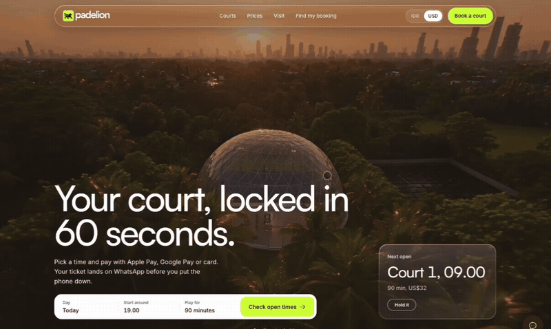</a>

</div>

Padelion is a booking web app for a three-court padel venue in Kemang, South Jakarta. Players see live availability, hold a court for 15 minutes, pay a deposit or the full amount and get a ticket with a check-in QR. The front desk and the owner run the day from one dashboard.

## The problem

Most padel venues in Jakarta still take bookings over WhatsApp. A player asks what is free, waits for a reply, sends a transfer screenshot and waits again. Unpaid holds block prime slots, rain on the outdoor court means a round of calls, and the desk chases balances by hand.

## What it does

**Players (no account)**
- Live availability for three courts. Pick a day, a length (60, 90 or 120 minutes) and a start time.
- A 15 minute hold with a countdown. Add rackets, balls or a towel.
- Pay a 50% deposit or the full amount (sandbox payment in this version).
- A ticket with the booking code, balance due, check-in QR, calendar export and share.
- Free reschedule up to 12 hours before play.
- Waitlist for taken slots, with a 15 minute offer when a slot frees up.
- Find my booking by WhatsApp number and a one-time code.
- Check-in at the venue by scanning the QR or typing the code.

**Front desk**
- Today: tonight's court timeline, balances due before play, running holds, waitlist offers and rain mode.
- Bookings with search and filters, payments to check (overpaid, no code, late), court blocks and the waitlist.

**Owner**
- This week: revenue, bookings made without a chat, court use by day and hour, holds released automatically and the system log.
- Prices, booking rules, add-ons and staff.

**Automatic**
- Every minute the database releases expired holds, offers freed slots to the waitlist and queues reminders.
- Demo data rebuilds itself every day at 05.00 Jakarta time.

## Screens

### For players

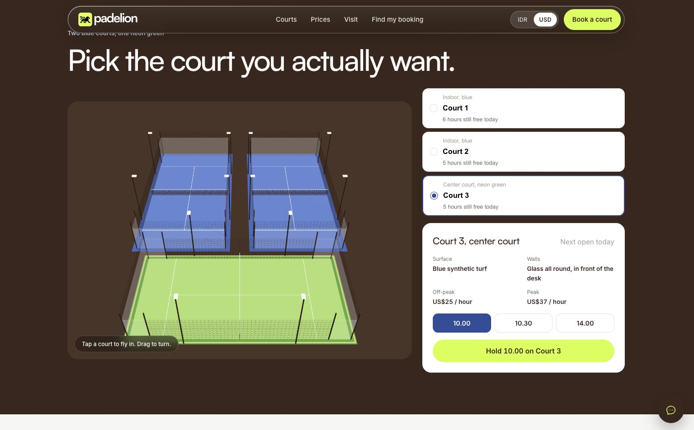

| Book your court | Held for you, 15 minutes |
|---|---|
| 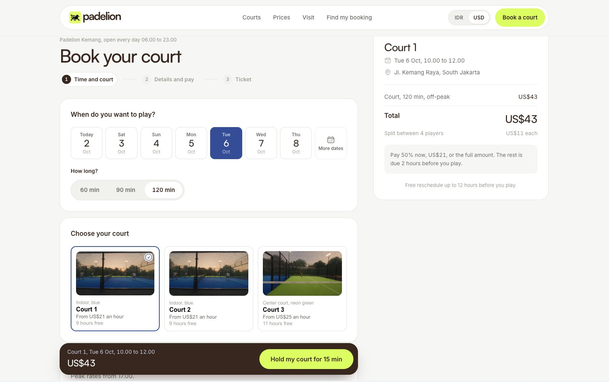 | 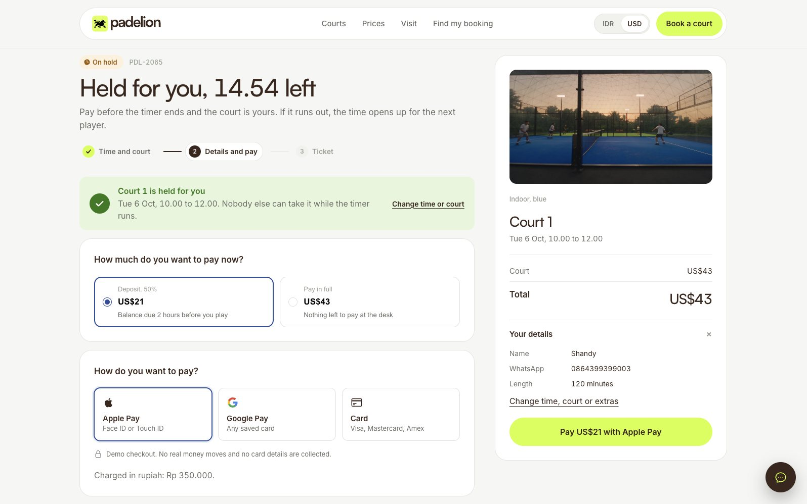 |
| **Your ticket** | **Check-in at the venue** |
| 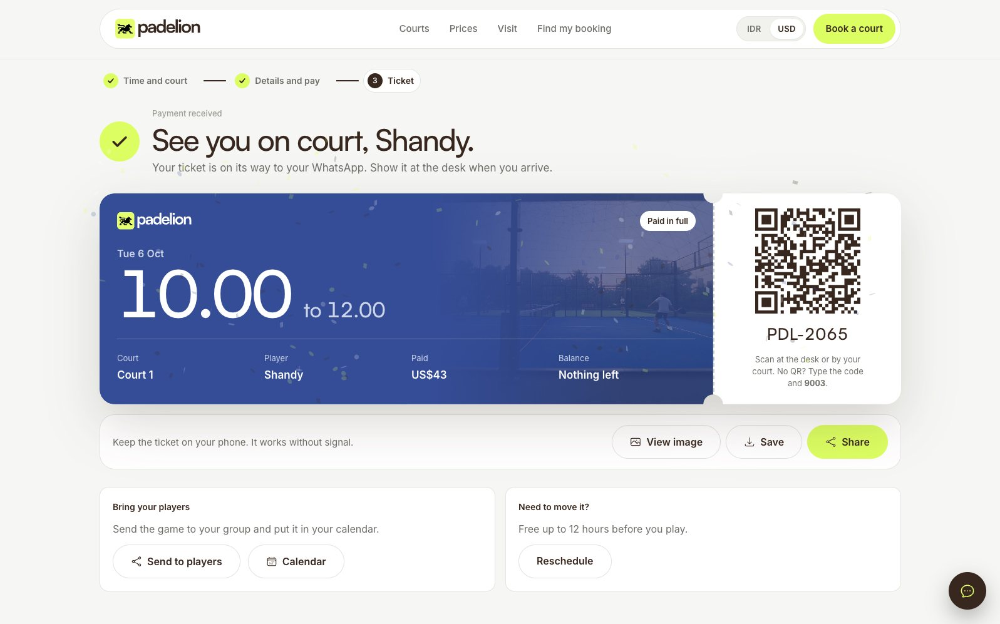 | 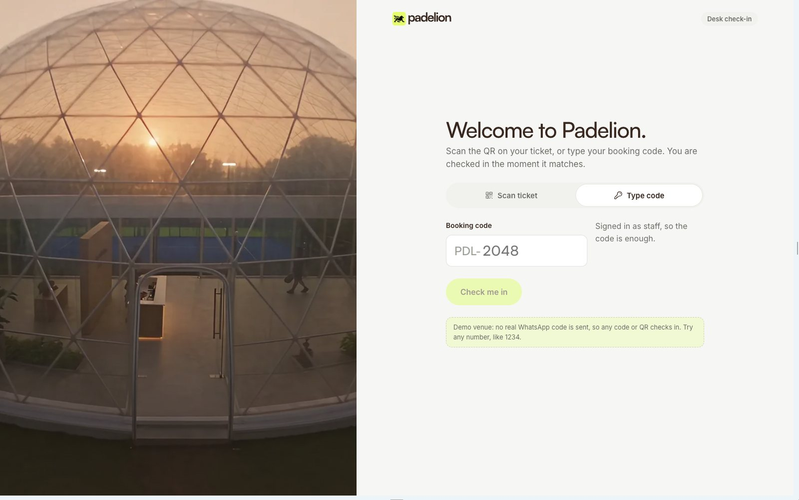 |

<p align="center">
  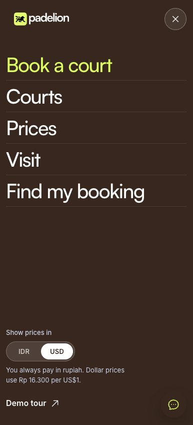
  &nbsp;
  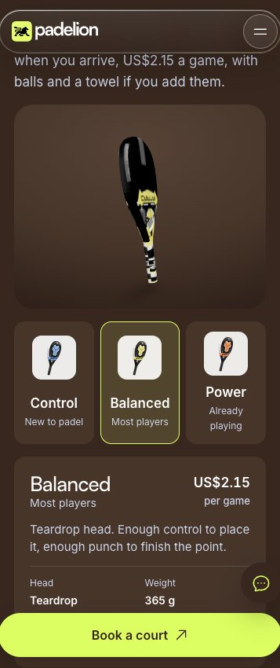
  &nbsp;
  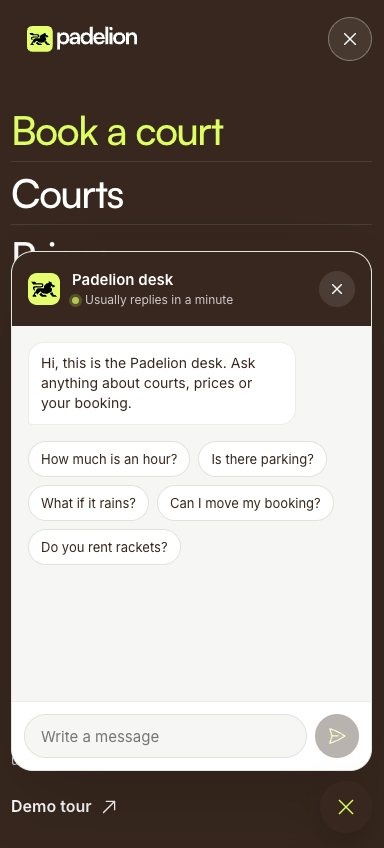
</p>

### For the venue

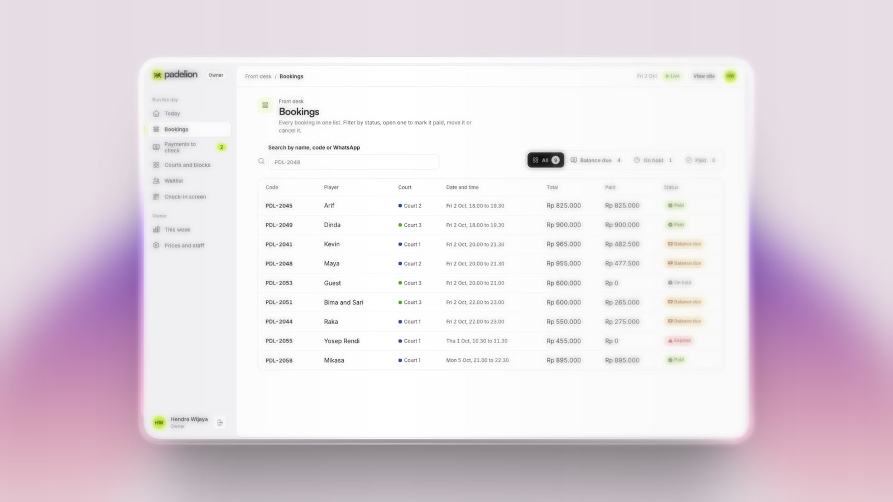

| Owner, this week | Payments to check |
|---|---|
| 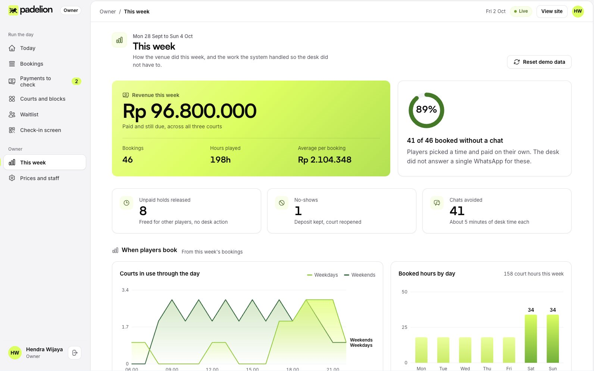 | 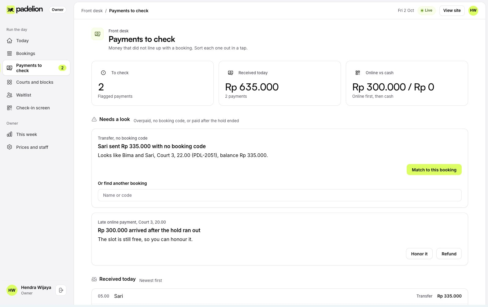 |
| **Booking detail** | **Prices and staff** |
| 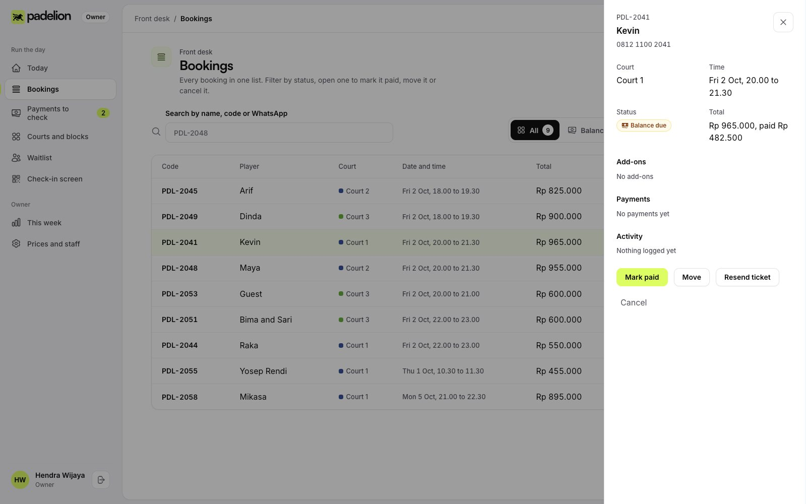 | 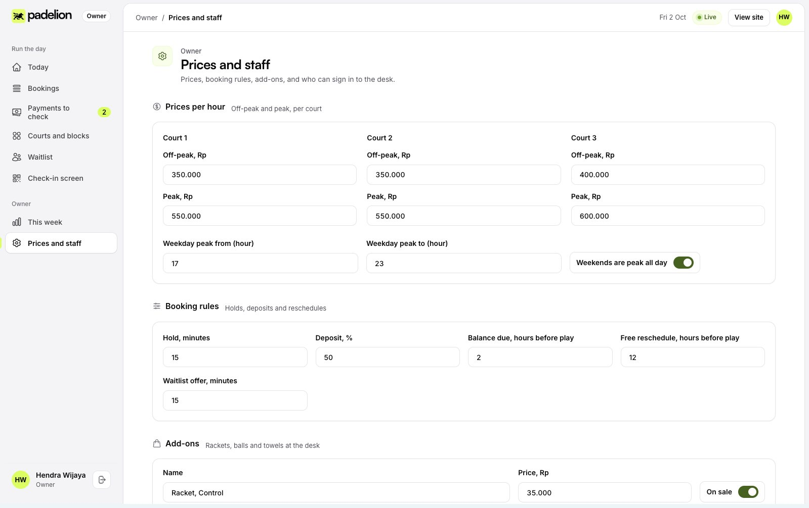 |

More in the [screen gallery](docs/screens.md).

## How it works

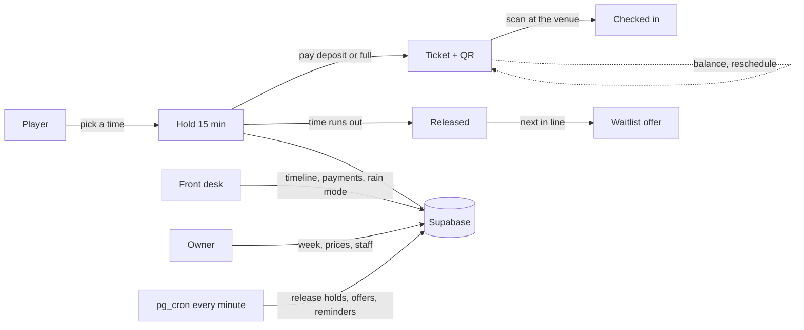

### Booking lifecycle

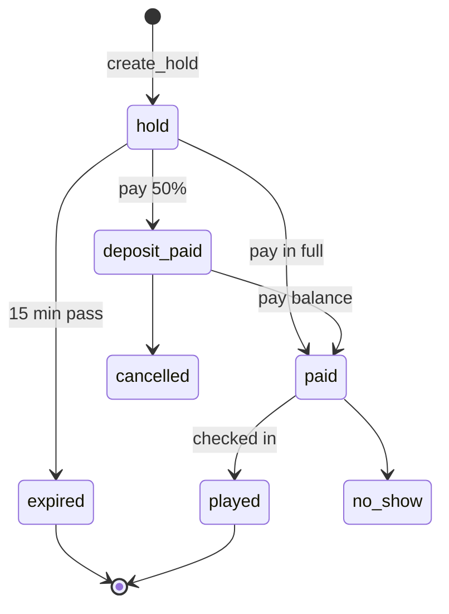

## Tech stack

| Layer | Choice |
|---|---|
| App | TanStack Start, TanStack Router and Query, React 19, TypeScript, Vite |
| Data | Supabase: Postgres, row level security, Auth, Realtime, pg_cron |
| Styling | A custom CSS design system in `src/design-system/padelion` (no Tailwind) |
| Motion and 3D | GSAP ScrollTrigger, three.js with React Three Fiber and drei |
| Other | qrcode, jsQR, canvas-confetti, Recharts, date-fns, zod, Heroicons |
| Hosting | Cloudflare Workers (any host that runs TanStack Start works) |

## Project structure

```
src/
  routes/            pages (player) and _staff/ (desk, owner)
  components/        landing, player, staff
  design-system/     Padelion tokens and base components
  integrations/      Supabase clients and types
  lib/               booking helpers, queries, formatting
supabase/migrations/ schema, RPCs, policies, scheduled jobs
docs/                product, architecture, database, design
```

## Quick start

```sh
bun install
cp .env.example .env   # fill in your Supabase project
bun run dev
```

Then apply the database migrations in `supabase/migrations` to your Supabase project. Full steps in [docs/setup-and-deployment.md](docs/setup-and-deployment.md).

## Demo accounts

| Role | Email | Password |
|---|---|---|
| Front desk (Dewi) | desk@padelion.demo | Padelion2026 |
| Owner (Hendra Wijaya) | owner@padelion.demo | Padelion2026 |

These accounts are created by the app on first sign-in and only reach demo data. Change them before running a real venue. Open `/demo` for a five step tour.

## Documentation

| Doc | What is inside |
|---|---|
| [Screens](docs/screens.md) | Every page, player and venue |
| [Product](docs/product.md) | Problem, users, flows, booking rules, scope |
| [Architecture](docs/architecture.md) | How the app, database and jobs fit together |
| [Routes](docs/routes.md) | Every page, who uses it and what it does |
| [Database](docs/database.md) | Tables, functions, access rules and scheduled jobs |
| [Design system](docs/design-system.md) | Tokens, type, components, motion and copy rules |
| [Setup and deployment](docs/setup-and-deployment.md) | Local setup, environment, Supabase and hosting |
| [Roadmap](docs/roadmap.md) | Done and next |

## Status

This is a working demo. Payments use a sandbox and WhatsApp messages are written to a `notifications` table instead of being sent. See the roadmap for the production steps.

## Author

Designed and built by [Yosep Rendi](https://github.com/yosrend), product designer at Morae Studio.
