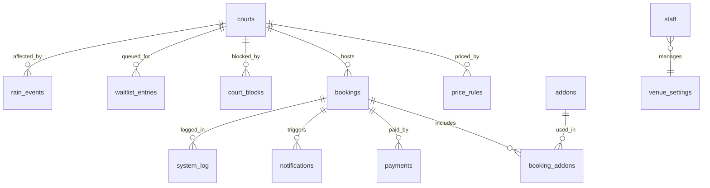

# Database

Postgres on Supabase. The full schema is in `supabase/migrations`, applied in file order.

## Entity diagram

## Tables

| Table | Holds | Who can read or write |
|---|---|---|
| `courts` | Name, kind (indoor or outdoor), sort order, active flag | Anyone reads. Owner manages |
| `price_rules` | Off-peak and peak price per court, peak hours, weekend rule | Anyone reads. Owner manages |
| `addons` | Rackets, balls, towel, with price and active flag | Anyone reads. Owner manages |
| `venue_settings` | One row: hold minutes, deposit %, balance hours, reschedule hours, offer minutes | Anyone reads. Owner updates |
| `bookings` | Code (`PDL-2048`), court, start and end, guest name and WhatsApp, status, totals, paid amount, balance due time, hold expiry, check-in time, `is_demo` | Staff only. Guests use RPCs |
| `booking_addons` | Add-ons per booking with quantity and unit price | Staff only |
| `payments` | Amount, method (`qris`, `va`, `cash`), status, flag (`overpaid`, `no_code`, `late`) | Staff only |
| `waitlist_entries` | Court and start time, guest, position, status (`waiting`, `offered`, `taken`, `passed`, `expired`), offer expiry | Staff only. Guests use RPCs |
| `court_blocks` | Blocked time per court with a reason | Staff only. Shown as taken on /book |
| `rain_events` | Rain mode periods for the outdoor court | Staff only |
| `notifications` | Queued WhatsApp messages (kind, body, send time, sent time) | Staff only |
| `staff` | Auth user, name, role (`front_desk` or `owner`), email | Staff read. Owner manages |
| `system_log` | What the system did automatically (hold released, offer sent) | Staff only |
| `week_baseline` | Demo numbers for the owner week view | Owner reads |

Booking status moves through `hold`, `deposit_paid`, `paid`, then `played`, or ends as `expired`, `cancelled` or `no_show`.

## Functions

**Guest RPCs** (SECURITY DEFINER, callable by anon)

| Function | Does |
|---|---|
| `get_availability` | Open, taken and held slots per court for a day, including blocks |
| `create_hold` | Checks the slot is free, prices it, creates a `hold` booking with an expiry |
| `get_booking` | One booking by code plus WhatsApp number |
| `find_bookings` | Every booking for a WhatsApp number after the one-time code |
| `pay_booking` | Sandbox payment of the deposit or full amount, sets the balance due time |
| `pay_balance` | Sandbox payment of the remaining balance |
| `reschedule_booking` | Moves a booking inside the free reschedule window, keeping what was paid |
| `join_waitlist`, `get_offer`, `take_offer`, `pass_offer` | Waitlist entry and the offer flow |
| `check_in` | Marks a booking checked in from the code and the last 4 WhatsApp digits |

**Staff RPCs** (role checked inside)

`my_staff`, `mark_paid`, `resolve_payment`, `move_booking`, `cancel_booking`, `create_block`, `waitlist_offer_now`, `waitlist_remove`, `end_hold_and_offer`, `owner_week`, `reset_demo`.

**Helpers**

`vs()` reads venue settings, `price_for()` prices a slot, `slot_free()` checks overlap with bookings and blocks, `booking_is_active()`, `norm_wa()` normalises WhatsApp numbers, `is_staff()` and `is_owner()` power the policies, `offer_next()` hands a slot to the next waitlist entry.

## Scheduled jobs

Set up by `supabase/migrations/20261018000000_schedule_jobs.sql` with pg_cron:

| Job | Schedule | Does |
|---|---|---|
| `padelion-minute-jobs` | Every minute | `run_minute_jobs()`: release expired holds, end expired offers and offer the slot to the next player, queue reminders, write to `system_log` |
| `padelion-demo-reset` | 22.00 UTC (05.00 Jakarta) | `reset_demo()`: rebuild demo rows for today and restore settings, prices, add-ons and staff |

## Demo data

- Every row a guest creates while payments are sandbox is marked `is_demo = true`, so the nightly reset clears it.
- The demo story uses one consistent cast: Maya on Court 2 (`PDL-2048`), Kevin, Raka, Arif, Dinda, Bima and Sari.
- For a real venue, set the `is_demo` defaults back to `false` and remove the demo reset job.
